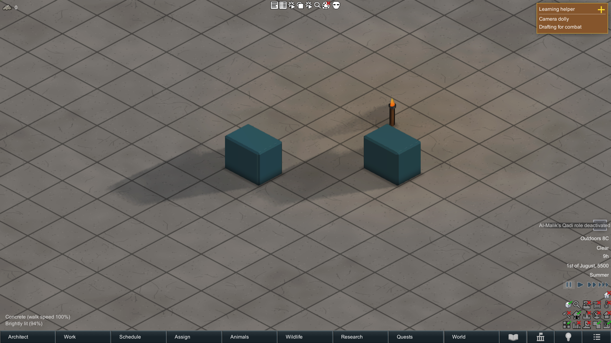
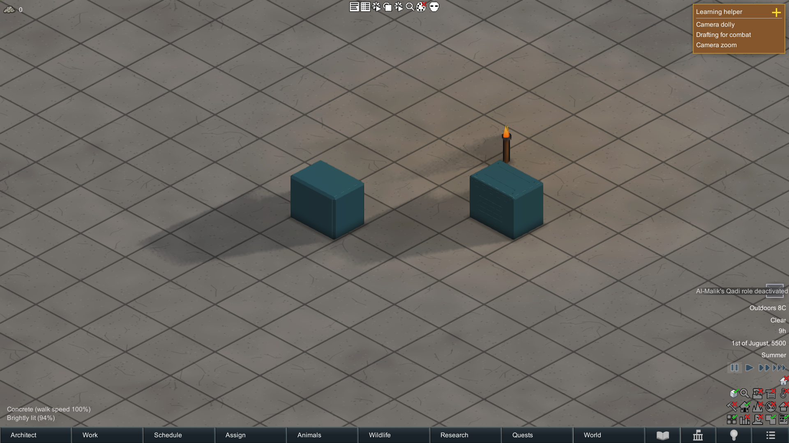

# Same-save comparison, 2026-11-07

All three runs load the same saved map, pause simulation, and use pitch 32/yaw 0 at camera sizes 7/13/40. Each view settles for five seconds, then records 360 GameComponentUpdate wall-clock frame intervals. Resolution in the raw captures is 1920 x 1080. These are single-pass smoke measurements, not GPU timings, confidence intervals or an FPS claim. No compilation was run during this final series. Each start recorded only its own RimWorld process; other system activity is not controlled.

| Configuration | Camera size | Samples | Mean ms | Median ms | p95 ms |
| --- | ---: | ---: | ---: | ---: | ---: |
| Unmodified upstream | 7 | 360 | 4.2062 | 4.1637 | 4.2790 |
| Unmodified upstream | 13 | 360 | 4.2201 | 4.1785 | 4.4162 |
| Unmodified upstream | 40 | 360 | 6.5544 | 6.5506 | 7.3540 |
| Candidate, no addon | 7 | 360 | 4.1885 | 4.1659 | 4.2743 |
| Candidate, no addon | 13 | 360 | 4.2040 | 4.1626 | 4.2804 |
| Candidate, no addon | 40 | 360 | 6.5933 | 6.6117 | 7.3051 |
| Candidate plus addon | 7 | 360 | 4.1872 | 4.1651 | 4.2988 |
| Candidate plus addon | 13 | 360 | 4.2079 | 4.1629 | 4.2604 |
| Candidate plus addon | 40 | 360 | 6.2514 | 6.1258 | 7.0958 |

The unused API retains the visible native rendering in this scene. With the addon, the right-hand crate gains baked surface detail. The left-hand crate is the normal-strength-zero control. Camera position, save and building rotation match; flame animation/UI hints can differ. The far view includes most of the map and is dominated by unrelated scene rendering. These samples do not establish a scalable LOD speedup or a statistically bounded zero overhead.

Earlier captures with a debug popup were rejected for visual review. A second capture series had timing spikes (including overlapping local compilation); its measurements are also excluded from the final table. Those traces are retained locally rather than silently overwritten. The final series above was taken after the final code build.

## Unmodified upstream

## Candidate API without addon

## Candidate with addon

Images are unedited full-resolution game captures. Raw assertion logs and static verification are adjacent to this file.
